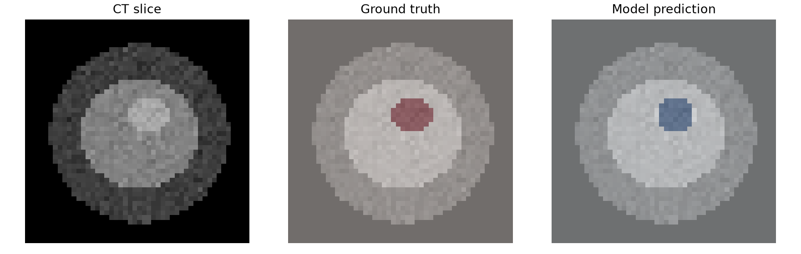

# 3D CT 病灶分割 Demo

这是一个面向高精密影像设备算法岗位的学习项目。它用合成的小动物 CT 体数据，走通“数据生成与版本管理 → 防泄漏切分 → 传统算法基线 → 3D U-Net → 评测与错误分析 → TorchScript/ONNX 部署”的完整链路。

它不是实际工作经历，也不能写成已经参与过商业 CT 产品。面试时应表述为：**为了理解目标岗位，我独立完成的学习型 Demo**。

## 一键运行

```bash
conda activate multimodal311
pip install -r requirements.txt
python -m unittest discover -s tests -v
python run_demo.py --epochs 10 --device cpu
```

本项目默认使用 CPU。部分 macOS/PyTorch 组合虽然能检测到 Apple MPS，但不完整支持 `Conv3d`，会在模型第一层报错。只有确认当前版本支持 3D 卷积时，才尝试 `--device mps`。

首次完整运行会生成：

- `data/manifest.json`：数据版本、subject/case、train/val/test 切分和内容哈希；
- `artifacts/model.pt`：训练检查点；
- `artifacts/test_metrics.csv`：逐病例 Dice、IoU、Sensitivity；
- `artifacts/summary.json`：总体结果与最差病例；
- `artifacts/prediction.png`：切片、真值、预测可视化；
- `artifacts/model.ts`、`model.onnx`：部署模型；
- `artifacts/deployment.json`：输入规格、延迟和模型大小。

部署文件还会记录 ONNX 与 PyTorch 输出的最大绝对误差；只有误差小于 `1e-4` 才标记为一致性通过。导出成功不等于模型可用，数值对齐是上线门槛。

## 已验证运行结果

以下结果来自 `multimodal311` 环境、CPU、10 个 epoch 的完整运行：

| 项目 | 结果 |
|---|---:|
| 测试体数据数 | 10 |
| 3D U-Net 平均 Dice | 0.8036 |
| 传统 HU 阈值基线平均 Dice | 0.9573 |
| 最差病例 | mouse-005-v2 |
| TorchScript CPU 推理延迟 | 约 83.7 ms |
| TorchScript 模型大小 | 约 0.115 MB |
| ONNX 导出 | 成功 |
| ONNX 与 PyTorch 最大绝对误差 | 9.54e-7 |
| ONNX 数值一致性 | 通过 |

传统算法在这组合成数据上优于深度学习模型并不是失败。这里的病灶灰度规则明确、数据量很小，HU 阈值天然占优；它说明产品方案应先建立简单、可解释的基线，再判断复杂模型是否带来真实增益。真实 CT 数据存在伪影、噪声、跨设备域偏移和复杂边界，不能据此推断传统算法在真实场景中仍会保持同样优势。



